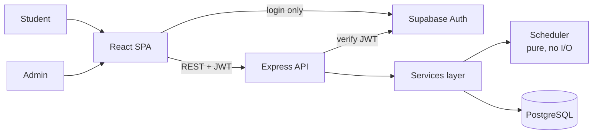

# FairBench

**Fair, explainable scheduling for a shared university lab.**


---

## The problem

Dr. Haque's lab has **one microscope, one centrifuge, and one slow
spectrophotometer** for about twenty students. Booking happens on a paper sheet
on the door, which produces double bookings, arguments, and week-long claims.
Some samples expire and cannot move; some runs cannot be interrupted; machines
break; the PI's own research takes machines without a record. Whoever asked in
the corridor last tends to win.

FairBench replaces the sheet with a scheduler that places every request by a
**transparent rule**, explains the outcome in plain language, and gives the lab
manager an override that shows its cost before it is applied.

## What makes it different

Most booking tools are calendars: the user picks a slot and the system stores it.
FairBench decides the slot. That inverts the hard part, and the design leans on
three guarantees:

| Guarantee | How it is enforced |
|---|---|
| **No double booking, ever** | A PostgreSQL exclusion constraint on `(machine_id, tstzrange(start_at, occupied_until))` — not application logic |
| **Deterministic placement** | The scheduler is a pure function of its input. Same input, same plan, every time — covered by a dedicated test |
| **Explainable outcome** | Every placement and every rejection carries a stored, human-readable reason and a concrete suggestion |

Nothing in the scheduling path reads the clock, the network, or the database, so
the whole engine can be unit-tested without mocks.

## Reusing the scheduler

The placement engine is a standalone module: **930 lines, zero dependencies, no
database, no HTTP, no clock.** Copy the folder and call one function.

```bash
cp -r backend/src/scheduler  your-project/src/scheduler
```

```js
import { schedule } from './scheduler/index.js';

const { placements, unplaced } = schedule({
  now: new Date(),
  settings: { timezone: 'Asia/Dhaka', slotMinutes: 15, openingHours: { days: [0,1,2,3,4], start: '09:00', end: '17:00' } },
  machines: [{ id: 'm1', name: 'Microscope', bufferMinutes: 10 }],
  outages: [],
  kept: [],
  toPlace: [/* requests with a window and a duration */]
});
```

It answers the three questions any shared-resource booking system has to answer:
who gets the slot when demand exceeds supply (weighted score), whether everyone
can be fitted by moving one thing (single-move repair), and why a request got the
slot it got (a stored reason and a suggestion). Nothing in it is specific to
microscopes — machines, rooms, benches and people all fit the same model.

→ **[Full API, scoring rules and a worked example](backend/src/scheduler/README.md)**

---

## Repository layout

```
fairbench/
├── frontend/     React + Vite single-page app (student and admin)
├── backend/      Express API, services layer, and the scheduling engine
└── database/     PostgreSQL migrations, seed script, concurrency check
```

Three deployables, one repository. Each folder has its own `package.json`.

## Architecture



| Layer | Folder | Responsibility |
|---|---|---|
| Presentation | `frontend/src` | Pages, forms, calendar, query cache |
| API | `backend/src/routes` | HTTP, validation, auth, error shape. No business rules |
| Services | `backend/src/services` | Workflows, transactions, audit, notifications |
| Scheduler | `backend/src/scheduler` | Pure placement logic |
| Data | `database/`, `backend/src/db` | Schema, constraints, RLS, queries |

**Dependency rule:** routes call services, services call the scheduler and the
data layer, the scheduler calls nothing. The frontend talks only to the API and
to Supabase Auth — it never touches the database directly.

> **Where the wiring stands.** The scheduler, services, and database layers are
> built and tested, but the HTTP routes currently answer from an in-memory store
> (`backend/src/routes/dataStore.js`) seeded with realistic fixtures. Connecting
> the routes to the services layer and Postgres is the remaining integration
> step — the API contract does not change when that happens.

The intended request path, once routes are wired to the services:

1. `POST /api/requests` with a JWT
2. Route validates the body with `zod`, loads the user's role
3. Service opens a transaction, takes an advisory lock, loads current state
4. Scheduler returns `placements` and `unplaced` with reasons
5. Service writes bookings, updates requests, appends to the audit log
6. Commit — the exclusion constraint is the final guard against overlap

---

## Tech stack

| Concern | Choice |
|---|---|
| Frontend | React 18.3, Vite 5.4, Tailwind CSS 3.4, React Router 6.26 |
| Server state | TanStack Query 5 |
| Auth | Supabase Auth (JWT), `@supabase/supabase-js` |
| Backend | Node 20+, Express 4, `zod` validation |
| Database | PostgreSQL (Supabase), `btree_gist` for the exclusion constraint |
| Dates | `date-fns` + `date-fns-tz` (UTC in the database, `Asia/Dhaka` in the UI) |
| Tests | Vitest (backend), `supertest` for API routes |

---

## Getting started

### Prerequisites

- Node.js 20 or newer
- A Supabase project (free tier is enough)
- `git`

### 1. Configure secrets

```bash
cd backend
cp .env.example .env        # then fill in the values below
```

This one file is the single source of truth for server-side secrets — the
migration and seed scripts load `backend/.env` too, so there is no second copy
in `database/`.

| Variable | Where to find it |
|---|---|
| `SUPABASE_URL` | Project settings → API |
| `SUPABASE_SERVICE_ROLE_KEY` | Project settings → API (secret — backend only) |
| `SUPABASE_JWT_SECRET` | Project settings → API → JWT settings |
| `DATABASE_URL` | Project settings → Database → connection pooler |
| `SEED_PASSWORD` | Anything you like; used for the demo accounts |

### 2. Database

```bash
cd database
npm install
npm run migrate             # applies 001 → 005 in order
npm run seed                # 1 admin, 20 students, ~25 requests, one outage demo
```

`npm run test` runs the concurrency check — 20 parallel submissions must produce
zero overlapping bookings.

The schema needs the `btree_gist` extension. Migration `001` creates it, but the
extension must be available on your Supabase instance (it is by default).

### 3. Backend

```bash
cd backend
npm install
npm run dev                 # http://localhost:4000
```

`GET /api/health` should answer `{ "status": "ok", "db": true }`.

### 4. Frontend

```bash
cd frontend
npm install
cp .env.example .env        # VITE_SUPABASE_URL, VITE_SUPABASE_ANON_KEY
npm run dev                 # http://localhost:5173
```

Sign in with the seeded admin account, or create a student through the admin
panel. To make an existing account an admin:

```sql
update profiles set role = 'admin' where email = 'you@example.com';
```

### Environment variables

**Backend** (`backend/.env`)

| Variable | Purpose |
|---|---|
| `PORT` | API port, default `4000` |
| `SUPABASE_URL` | Supabase project URL |
| `SUPABASE_SERVICE_ROLE_KEY` | Server-side key — bypasses RLS, never ship to the browser |
| `SUPABASE_JWT_SECRET` | Verifies access tokens |
| `DATABASE_URL` | Postgres connection string (use the pooler) |
| `LAB_TIMEZONE` | Default `Asia/Dhaka` |
| `CORS_ORIGIN` | Frontend origin, default `http://localhost:5173` |
| `SEED_PASSWORD` | Password for seeded demo accounts |

**Frontend** (`frontend/.env`) — only `VITE_` variables reach the bundle.

| Variable | Purpose |
|---|---|
| `VITE_SUPABASE_URL` | Supabase project URL |
| `VITE_SUPABASE_ANON_KEY` | Public anon key (RLS protects the data) |
| `VITE_API_URL` | API base, default `http://localhost:4000` |
| `VITE_LAB_TIMEZONE` | Display time zone, default `Asia/Dhaka` |

---

## How the scheduler works

`backend/src/scheduler/` — a pure module with no database, HTTP, or clock access.

```js
schedule(input)              // -> { placements, unplaced, stats }
replan(input, change)        // -> stable re-plan after a pin, bump or outage
affectedBy(change, state)    // -> who a proposed change touches
```

### Scoring

Each factor is 0–100; weights live in the `settings` table and are normalised
over the enabled factors.

| Factor | Formula | Enabled |
|---|---|---|
| `deadline` | `100 × clamp(1 − hoursToDeadline / 168, 0, 1)` | V1 |
| `tightness` | `100 × (1 − slack / availableMinutes)` | V1 |
| `waiting` | `100 × clamp(hoursWaiting / 72, 0, 1)` | V2 |
| `fairness` | `100 × (1 − clamp(usage / (quota × 2), 0, 1))` | V2 |

### Ordering

Fixed requests first, then higher score, then nearer deadline, then earlier
submission, then lower id. Every step is total and stable, which is what makes
the output reproducible.

### Placement and repair

Requests are placed earliest-fit inside their window on a 15-minute grid, with
each machine's buffer added after the run. If a request cannot be placed, the
engine attempts **exactly one move** of a flexible booking to make room for both.
If that fails, the request is returned as unplaced with a reason and a suggestion
("widen your window by one day", "choose a shorter run", "ask Dr. Haque to review").

### Stable re-plan

A pin, bump, or outage does not re-run the whole schedule. Only the requests that
overlap the change are re-planned; everything else keeps its slot. Bookings that
have already started are never touched — they surface as warnings instead.

---

## Data model

Eight tables: `profiles`, `machines`, `requests`, `bookings`, `outages`,
`audit_log`, `settings`, `notifications`.

Design decisions worth knowing:

- **The overlap rule is a database constraint**, not application code:
  ```sql
  constraint no_double_booking exclude using gist (
    machine_id with =,
    tstzrange(start_at, occupied_until) with &&
  ) where (status = 'active')
  ```
- **`audit_log` is append-only** — a trigger raises an exception on any update or
  delete, so an override cannot be quietly erased.
- **`occupied_until`** stores the end plus the machine's buffer, so buffers are
  enforced by the same constraint as the run itself.
- **`settings` is data, not code** — opening hours, slot size, quotas, and scoring
  weights are editable by an admin without a deployment.
- **RLS is enabled on every table.** The API uses the service role and bypasses
  it; the policies exist so a direct call with the anon key still cannot read
  another student's requests.
- **`schedule_public`** is a view for the calendar that hides student names when
  `show_names` is off, while admins always see them.

---

## API surface

Base URL `/api`. JSON in and out. All routes require
`Authorization: Bearer <supabase access token>` except `/api/health`.

| Group | Endpoints |
|---|---|
| Session | `GET /me` |
| Machines | `GET /machines` |
| Requests | `POST /requests`, `GET /requests/mine`, `PATCH /requests/:id`, `POST /requests/:id/cancel` |
| Schedule | `GET /schedule?machineId=&from=&to=`, `GET /bookings/mine` |
| Settings | `GET /settings`, `PUT /settings` |
| Notifications | `GET /notifications`, `POST /notifications/:id/read`, `POST /notifications/read-all` |
| Admin | `POST /admin/changes/preview`, `POST /admin/changes/apply`, `GET /admin/requests`, `GET /admin/outages`, `GET /admin/attention`, `GET /admin/dashboard`, `GET /admin/audit`, `GET/POST/PATCH /admin/users` |
| Ops | `GET /health` |

Errors use one shape everywhere:

```json
{ "error": { "code": "VALIDATION_ERROR", "message": "Window is shorter than duration", "details": [] } }
```

Admin changes are two-phase: `preview` returns the diff and a hash without saving
anything, `apply` requires that hash and returns `409 PREVIEW_STALE` if the
schedule moved underneath it.

---

## Roles and screens

| Role | Screens |
|---|---|
| **Student** | Request form, my bookings, lab calendar, notifications |
| **Admin** | Dashboard, override (pin / bump / reserve), machines and outages, needs attention, audit history, users, settings |
| **Visitor** | Read-only calendar |

Routes: `/login`, `/request/new`, `/my`, `/calendar`, `/notifications`, and
`/admin/*`. A `RequireAuth` guard wraps every page except login; the API enforces
roles independently, so the UI guard is convenience, not security.

---

## Testing

```bash
cd backend && npm test        # 13 suites, 33 tests
cd database && npm test       # concurrency check against a live database
cd frontend && npm run build  # type/import verification
```

The suite concentrates on the parts that are expensive to get wrong rather than
chasing coverage:

- **Scheduler (10 suites)** — overlap, buffer spilling past closing time, grid
  alignment, fill-gaps, no-split across closing, deadline risk, determinism
  (same input twice → same output), one-move repair, stable re-plan, waiting
  priority
- **API (3 suites)** — route behaviour, validation, authorization

The frontend has no unit tests; it is verified by building and by manual flows.

---

## Project status

| Area | State |
|---|---|
| Scheduler engine | Complete — 10 test suites, pure and deterministic |
| Services + schema | Complete — migrations `001`–`005`, seed script, concurrency check |
| API routes | Implemented against an **in-memory store**; not yet wired to services/Postgres |
| Student UI | Complete — request, bookings, calendar, notifications |
| Admin UI | Complete — dashboard, override, machines, attention, history, users, settings |

| Release | Scope | State |
|---|---|---|
| **V1** | Login, request form, scheduler, reasons, calendar, my bookings, pin/bump, outages, audit log | Feature-complete |
| **V2** | Quotas, fairness and waiting factors, repair step, notifications, dashboard, settings, what-if preview | Partly — fairness and waiting factors exist but are disabled in settings |
| **V3** | QR check-in, adaptive buffer, time bank, usage report | Not started |

Known gaps, stated plainly:

- **Routes still read the in-memory store.** The services layer and migrations are
  ready; replacing the store with real queries is the next integration step.
- Notifications are in-app only; there is no email delivery yet.
- The calendar polls every 30 seconds rather than subscribing to Supabase Realtime.
- Quota enforcement exists in validation; the weekly usage report is V3.

---

## Team

| Person | Ownership |
|---|---|
| **Sabbir** | Database, scheduler engine, services layer, audit and notifications |
| **Aranno** | Express API, auth and validation middleware, admin screens |
| **Sirat** | Shared UI components, student pages, calendar, settings and health routes |

Built as a university software engineering project, November 2026.

---

## Contributing

Issues and pull requests are welcome — see [CONTRIBUTING.md](CONTRIBUTING.md) for
the setup, the layer boundaries, and the two commands a change must pass.

## License

[MIT](LICENSE) © 2026 FairBench contributors.

The scheduling engine is the part most worth borrowing. It is deliberately
dependency-free so it can be lifted into another project without dragging the
rest of this one along.
