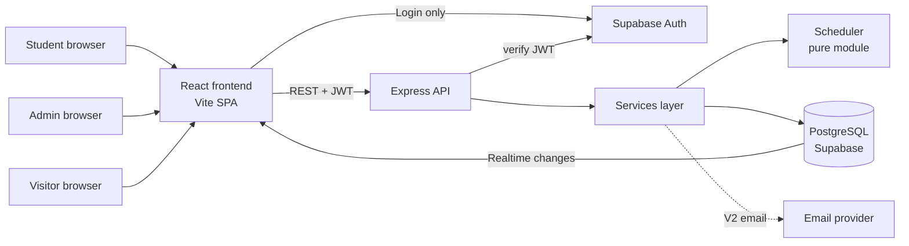
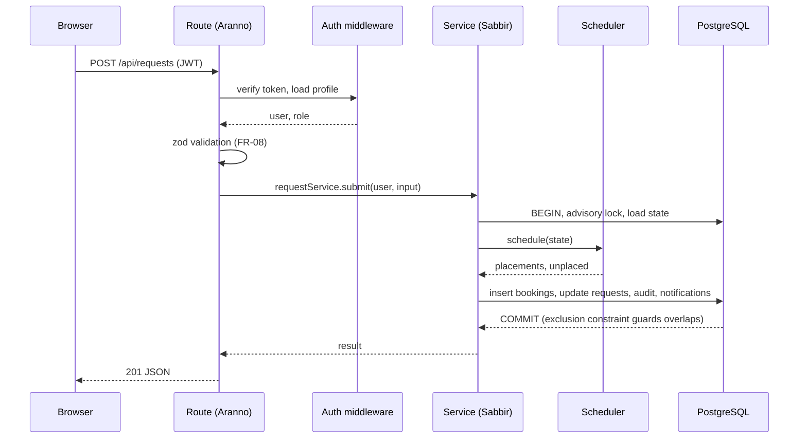

# ARCHITECTURE: FairBench

Owners: Aranno (API layer), Sabbir (data and engine), Sirat (frontend).

## 1. Context

## 2. Layers and responsibilities

| Layer | Folder | Owner | Responsibility |
|---|---|---|---|
| Presentation | `frontend/src` | Sirat (shared, student), Aranno (admin) | Pages, forms, calendar, state, mock mode |
| API | `backend/src/routes`, `middleware`, `app.js` | Aranno (Sirat: settings, notifications, health) | HTTP, validation, auth, error format. No business rules |
| Services | `backend/src/services` | Sabbir | Business workflows, transactions, audit, notifications |
| Scheduler | `backend/src/scheduler` | Sabbir | Pure scheduling logic. No I/O |
| Data | `database/`, `backend/src/db` | Sabbir | Schema, constraints, RLS, queries |

**Dependency rule:** routes call services. Services call the scheduler and the data layer. The scheduler calls nothing. The frontend only talks to the API and to Supabase Auth.

## 3. Request lifecycle

## 4. Deployment

| Part | Host (suggested) | Notes |
|---|---|---|
| Frontend | Vercel or Netlify | Static build, env `VITE_*` |
| Backend | Render, Railway or Fly.io | Node 20, env secrets, health route `/api/health` |
| Database and Auth | Supabase | Daily backups, RLS on, connection pooler for the backend |
| Local development | `npm run dev` for both, Supabase project or local Supabase CLI | |

## 5. Security architecture

- Supabase Auth issues JWTs. The API verifies them and loads the role from `profiles`.
- RLS is the second line of defence if anyone calls Supabase directly with the anon key.
- Service-role key lives only in the backend environment.
- Rate limiting on write routes. `helmet` headers. CORS limited to the frontend origin.
- Audit log is append-only (trigger).
- Inputs are validated with `zod` at the route and re-checked in the service.

## 6. Configuration

| Source | Content |
|---|---|
| Environment variables | Keys, URLs, time zone default (see `README.md`) |
| `settings` table | Opening hours, slot size, quotas, weights, grace period, show names. Editable by admin without code changes |

## 7. Cross-cutting concerns

| Concern | Decision |
|---|---|
| Time | UTC in database, lab time zone in UI (`Asia/Dhaka`) |
| Errors | One format: `{ "error": { "code", "message", "details" } }` |
| Logging | `pino`, no secrets, no personal data in logs |
| Realtime | Calendar subscribes to Supabase Realtime on `bookings` (fallback: refetch every 30 seconds) |
| Testing | Scheduler unit tests, API integration tests, concurrency test (see `TESTING.md`) |
| Performance | Whole problem fits in memory, recalculation target under 3 seconds |
