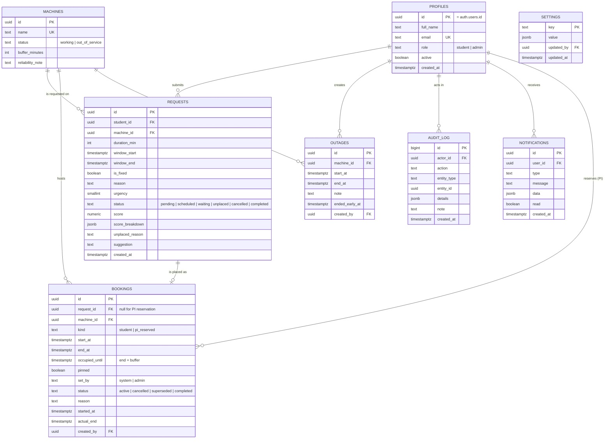
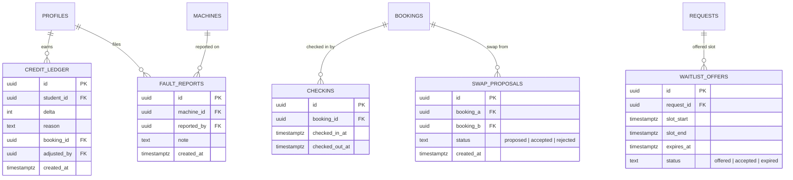

# ERD: FairBench entity relationship diagram

Database: PostgreSQL on Supabase. Full SQL is in `DATABASE.md`. Owner: Sabbir.

## 1. Version 1 entities

`SETTINGS` is a standalone key-value table (hours, slot size, quotas, weights, time zone).

## 2. Later versions (V3 and V4)

## 3. Relationship rules

| Rule | How it is enforced |
|---|---|
| A request has at most one active booking | Unique index on `bookings(request_id)` where `status = 'active'` |
| No two active bookings overlap on one machine | `EXCLUDE USING gist` on `(machine_id, tstzrange(start_at, occupied_until))` |
| PI reservations have no request | `request_id` is null and `kind = 'pi_reserved'` |
| A fixed request must have a reason | Check constraint on `requests` |
| Audit rows cannot be changed | Trigger blocks update and delete |
| Only admins write bookings, outages, settings | RLS plus server role check |
