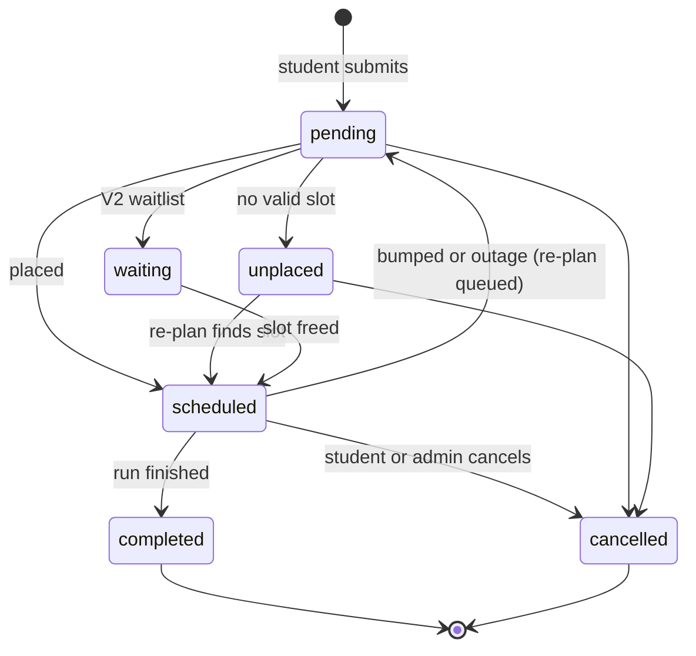
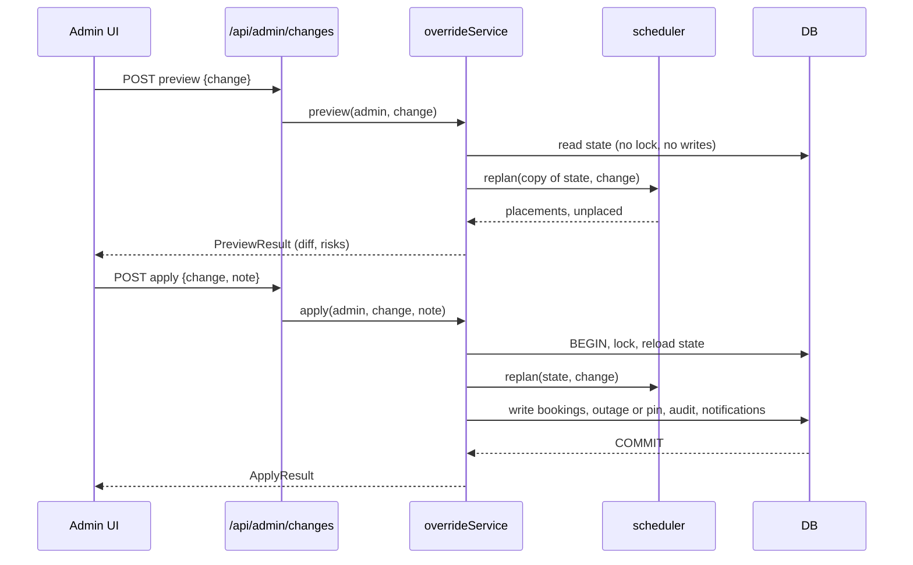

# SYSTEM_DESIGN: FairBench

Owners: Sabbir (services, concurrency), Aranno (API behaviour). Read with `ARCHITECTURE.md`, `SCHEDULER_SPEC.md` and `API_SPEC.md`.

## 1. Design principles

1. **One scheduling brain.** Initial scheduling, overrides, outages and cancellations all call the same scheduler (FR-44).
2. **Stable by default.** Only affected bookings may change (FR-39). Started and pinned bookings never move (FR-40).
3. **The database is the last line of defence.** Overlaps are impossible by constraint (NFR-03).
4. **Explain, never hide.** Each outcome stores a reason. Nothing disappears (FR-17).
5. **Preview before commit.** Admin changes are simulated on a copy first (AF-01).
6. **Deterministic.** Same input, same schedule (FR-45).

## 2. Request status state machine



`pending` is transient inside a transaction. After the scheduler runs, every request is `scheduled`, `unplaced` or `waiting`.

## 3. Booking lifecycle

| Status | Meaning | Can the scheduler move it? |
|---|---|---|
| `active` (not started, not pinned) | Normal booking | Yes, only if affected and the request is flexible, or during a re-plan of its own window |
| `active` + `pinned` | Admin fixed it | No |
| `active` + `started_at` set | Running | No (frozen) |
| `superseded` | Replaced by a re-plan (history row) | n/a |
| `cancelled` | Cancelled | n/a |
| `completed` | Finished | n/a |

A moved booking is not updated in place. The old row becomes `superseded` and a new `active` row is inserted, so history stays visible in the audit trail.

## 4. Key flows

### 4.1 Submit a request

1. Route validates input with `zod` and the FR-08 rules.
2. `requestService.submit` opens a transaction and takes the advisory lock.
3. It checks the quota (FR-10), inserts the request as `pending`.
4. It loads the state: kept bookings, outages, settings, usage.
5. It runs `scheduler.schedule` with the new request (plus any `unplaced` requests of the same machine so they get a chance too).
6. `bookingService.applyPlacements` writes bookings. The exclusion constraint guards overlaps.
7. It updates request status, reasons and score, writes audit and notifications, commits.

### 4.2 Admin change with preview



`apply` reloads the state inside the transaction. If the result differs from what the admin previewed (someone else changed the schedule), it returns `409 PREVIEW_STALE` with a fresh preview.

### 4.3 Outage

1. Preview: affected set is every unlocked, unstarted active booking on that machine overlapping the outage. Started bookings in the period are listed as **warnings**.
2. Apply: insert the outage row, set machine status if the outage covers now, mark affected bookings `superseded`, re-plan their requests in score order on the remaining time of the same machine, notify students (grouped), alert the admin for unplaced and deadline-risk cases, write audit.
3. End outage early (FR-31): update `ended_early_at`, then run the scheduler for `waiting` and `unplaced` requests of that machine.

### 4.4 Cancel a request
Mark booking `cancelled`, request `cancelled`, then offer the freed time to `waiting` and `unplaced` requests on that machine by re-running the scheduler for them. Later cancellations (inside the free-cancel period) are recorded for credits in V3.

## 5. Service contracts (Sabbir implements, Aranno and Sirat call)

All functions are `async`, take a `user` object `{ id, role }`, and throw `AppError(code, message, details)`.

```js
// requestService
submit(user, input)            // -> { request, booking | null }
update(user, requestId, patch) // -> { request, booking | null }  (own requests only, not started)
cancel(user, requestId)        // -> { request }
listMine(user)                 // -> Request[] with booking and reason

// scheduleQueries
getSchedule({ machineId, from, to, viewer }) // -> Block[] (names hidden if setting says so)
getMyBookings(user)                          // -> Booking[]
getAttentionList()                           // -> { unplaced: [], deadlineRisk: [], outageWarnings: [] }
getDashboard()                               // -> { pending, unplaced, activeOutages, recentOverrides }

// overrideService (also handles outages and reservations)
preview(admin, change)         // -> PreviewResult
apply(admin, change, note)     // -> ApplyResult
// change = { type: 'pin',        machineId, start, end, bookingId? | requestId? }
//        | { type: 'bump',       bookingId }
//        | { type: 'reserve',    machineId, start, end, recurrence? }
//        | { type: 'outage',     machineId, start, end, note }
//        | { type: 'end_outage', outageId }

// auditService / notificationService
auditService.log(client, { actorId, action, entityType, entityId, details, note })
notificationService.notifyGrouped(client, [{ userId, type, message, data }])
notificationService.notifyAdmins(client, { type, message, data })
```

**PreviewResult**

```json
{
  "summary": { "affected": 4, "moved": 3, "unplaced": 1, "atRisk": 1 },
  "changes": [
    {
      "requestId": "uuid", "studentName": "Rahim",
      "machine": "Microscope",
      "before": { "start": "2026-11-24T04:00:00Z", "end": "2026-11-24T07:00:00Z" },
      "after":  { "start": "2026-11-25T04:00:00Z", "end": "2026-11-25T07:00:00Z" },
      "outcome": "moved",
      "risk": false,
      "reason": "Moved to Wednesday 10:00: earliest free slot inside your window"
    }
  ],
  "warnings": [ { "code": "RUNNING_BOOKING", "bookingId": "uuid", "message": "A run is in progress and cannot be moved" } ]
}
```

## 6. Concurrency and consistency

| Situation | Protection |
|---|---|
| Two students submit at the same moment | Each submit runs in a transaction that first takes `pg_advisory_xact_lock(hashtext('fairbench_replan'))`. The second waits, then sees the first booking |
| Something slips through the lock | `EXCLUDE USING gist` rejects the overlapping insert with SQLSTATE `23P01`. The service maps it to `409 SLOT_TAKEN` and retries the scheduler once |
| Admin previews, then another change lands | `apply` reloads state and compares a state hash. Different hash gives `409 PREVIEW_STALE` |
| Failure mid re-plan | Single transaction, full rollback, nothing lost (NFR-05) |

With about 20 users, one global lock is simple and fast enough.

## 7. Error model

| HTTP | Code | When |
|---|---|---|
| 400 | `VALIDATION_ERROR` | Input fails FR-08 rules. `details` lists fields |
| 401 | `UNAUTHENTICATED` | Missing or invalid token |
| 403 | `FORBIDDEN` | Role not allowed, or editing someone else's request |
| 403 | `ACCOUNT_INACTIVE` | Deactivated account |
| 404 | `NOT_FOUND` | Unknown id |
| 409 | `SLOT_TAKEN` | Exclusion violation after retry |
| 409 | `PREVIEW_STALE` | Schedule changed since preview |
| 409 | `BOOKING_STARTED` | Attempt to move a running booking |
| 422 | `QUOTA_EXCEEDED` | Weekly limit (FR-10) |
| 500 | `INTERNAL` | Unexpected. Logged without secrets |

## 8. Notifications

- Created inside the same transaction as the schedule change, so there are no notifications for changes that rolled back.
- One re-plan produces at most one message per student (grouped, FR-32).
- Types: `booking_created`, `booking_moved`, `booking_bumped`, `booking_cancelled`, `request_unplaced`, `outage_affects_you`, and for admins `admin_unplaced`, `admin_deadline_risk`, `admin_outage_impact`.
- V1 delivery is in-app (table plus Realtime). Email arrives in V2.

## 9. Audit

Every admin action and every system re-plan writes one row: `action`, `entity`, `actor`, `details` (before and after summary), optional `note`. Rows are append-only. The admin history page shows them (FR-25). Preview actions are not logged; apply actions are.

## 10. Design decisions

| Decision | Reason |
|---|---|
| Greedy scheduler with a one-move repair instead of a constraint solver | Easy to explain, fast, deterministic. A solver can replace only the repair step later |
| Re-plan only affected bookings | Students do not lose good slots for no reason |
| Window plus duration instead of fixed slot | Prevents hoarding and allows packing |
| Global advisory lock | Small scale, simplest correct approach |
| Settings in a table | Admin can tune rules without a deploy (NFR-06) |
| Old booking rows kept as `superseded` | History and debugging |
